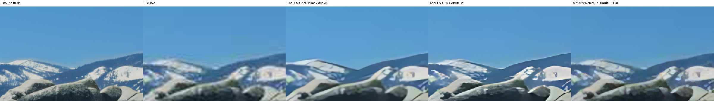
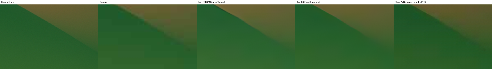
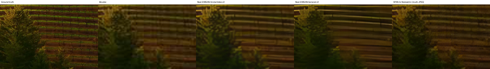

# Stage 6–8: модели, конвертация в Core ML и тест отдельно от плеера

Все таблицы ниже собраны скриптом `Tools/ml/make_report.py` из JSON-файлов в `Docs/data/`. Цифр,
набранных вручную, здесь нет. Пересчитать всё можно так:

```bash
.venv/bin/python Tools/ml/download_models.py      # Stage 6: веса с Hugging Face (+ manifest с ревизиями и SHA256)
.venv/bin/python Tools/ml/convert_to_coreml.py    # Stage 8: .mlpackage, ML Program, FP16
.venv/bin/python Tools/ml/evaluate_models.py      # Stage 7: корректность, качество, мерцание, скорость
.venv/bin/python Tools/ml/test_postprocessing.py  # проверка постобработки, которую применяет плеер
.venv/bin/python Tools/ml/make_report.py
```

## Что скачано (Stage 6)

| Модель | Источник (Hugging Face) | Лицензия | Параметры (инференс) |
|---|---|---|---|
| Real-ESRGAN AnimeVideo v3 | `mlx-community/Real-ESRGAN-animevideov3` (веса официального релиза, раскладка MLX → переложена в PyTorch) | BSD-3-Clause | 621 424 |
| Real-ESRGAN General v3 | `clavidk/realesr-general-x4v3` (оригинальный `.pth`) | BSD-3-Clause | 1 213 296 |
| SPAN ×2 NomosUni multi-JPEG | `Phips/2xNomosUni_span_multijpg` | CC-BY-4.0 (нужна атрибуция) | 410 700 |

Реконструкция проверена против независимого эталонного выхода (`skillsafe-ai/realesr-animevideov3`,
`reference/*.npy`): максимальное расхождение 1.66e-3, это уровень точности FP16-весов.

## Конвертация (Stage 8)

PyTorch → `torch.jit.trace` → coremltools 9 → ML Program, FP16, `macOS15+`. Вход и выход: тензоры Float16
`[1,3,H,W]`, RGB 0…1. Формы входа задаются как EnumeratedShapes: 16:9 (270p…1080p), 2.39:1 и 4:3. Так ANE получает
фиксированные формы, а плеер подаёт кадр без растяжения. Варианты ×2 у ×4-сетей усредняют результат 2×2 внутри модели.
Метаданные (`ve.*`) содержат источник, ревизию, SHA256 исходных весов, масштаб и список форм; `ModelManager`
проверяет их перед загрузкой.

<!-- model-eval:start -->
Machine: Apple M4, macOS 26.6.2, coremltools 9.0, torch 2.14.1.

### Core ML conversion correctness (FP16 Core ML vs FP32 PyTorch, same input)

| Model | PSNR Core ML vs PyTorch | Package |
|---|---|---|
| Real-ESRGAN AnimeVideo v3 ×2 | 74.9 dB | 1.28 MB |
| Real-ESRGAN General v3 ×2 | 72.4 dB | 2.50 MB |
| SPAN 2x NomosUni (multi-JPEG) ×2 | 58.5 dB | 0.86 MB |

### Quality vs ground truth (2560×1440 GT, 1280×720 input, ×2; mean of 3 photos)

PSNR/SSIM on luma: fidelity to the original. Detail = gradient energy of the result ÷ ground truth (< 1 softer than the original, > 1 sharper/hallucinated).


**Input degradation: bicubic**

| Method | PSNR dB | SSIM | Detail |
|---|---|---|---|
| Bilinear | 38.35 | 0.9346 | 0.43 |
| Bicubic | 39.20 | 0.9473 | 0.50 |
| Lanczos | 39.54 | 0.9519 | 0.53 |
| Real-ESRGAN AnimeVideo v3 | 33.84 | 0.9363 | 0.51 |
| Real-ESRGAN General v3 | 36.39 | 0.9343 | 0.61 |
| SPAN 2x NomosUni (multi-JPEG) | 31.96 | 0.9447 | 0.76 |

**Input degradation: bicubic+jpeg45**

| Method | PSNR dB | SSIM | Detail |
|---|---|---|---|
| Bilinear | 35.80 | 0.8877 | 0.36 |
| Bicubic | 35.84 | 0.8893 | 0.41 |
| Lanczos | 35.83 | 0.8893 | 0.43 |
| Real-ESRGAN AnimeVideo v3 | 32.26 | 0.8930 | 0.48 |
| Real-ESRGAN General v3 | 33.75 | 0.8773 | 0.54 |
| SPAN 2x NomosUni (multi-JPEG) | 30.56 | 0.8774 | 0.71 |

### Does AI help when the input must be reduced for speed? (720p JPEG source → 1440p GT)

| Method | PSNR dB | SSIM | Detail |
|---|---|---|---|
| Lanczos 720p→1440p (classical) | 36.38 | 0.8993 | 0.44 |
| AI full input: SPAN ×2 | 30.63 | 0.8853 | 0.72 |
| AI full input: General v3 ×2 | 34.16 | 0.8856 | 0.56 |
| AI full input: AnimeVideo v3 ×2 | 32.61 | 0.9017 | 0.50 |
| 360p input: AnimeVideo v3 ×4 | 31.47 | 0.8630 | 0.41 |
| 360p input: General v3 ×4 | 33.53 | 0.8602 | 0.55 |
| 540p input: General v3 ×2 + Lanczos | 34.21 | 0.8825 | 0.51 |

### Temporal flicker on sub-pixel pan (mean |ΔSR − ΔGT| between frames, 8-bit units, lower is better)

| Method | Flicker |
|---|---|
| Bicubic | 1.80 |
| Real-ESRGAN AnimeVideo v3 | 1.84 |
| Real-ESRGAN General v3 | 2.22 |
| SPAN 2x NomosUni (multi-JPEG) | 2.03 |

### Core ML latency, standalone (Python coremltools, includes array copies; median ms)

| Model | Compute | 640x360 | 960x540 | 1280x720 |
|---|---|---|---|---|
| realesr-animevideov3-x2 | CPU+GPU | 65.4 | 148.1 | 259.9 |
| realesr-animevideov3-x2 | CPU+ANE | 39.7 | 89.0 | 157.5 |
| realesr-animevideov3-x2 | ALL | 38.7 | 87.6 | 155.2 |
| realesr-general-x4v3-x2 | CPU+GPU | 123.7 | 279.7 | 491.9 |
| realesr-general-x4v3-x2 | CPU+ANE | 71.4 | 159.1 | 284.3 |
| realesr-general-x4v3-x2 | ALL | 71.7 | 159.7 | 283.3 |
| span-nomosuni-x2 | CPU+GPU | 59.3 | 132.7 | 234.9 |
| span-nomosuni-x2 | CPU+ANE | 25.2 | 54.1 | 96.0 |
| span-nomosuni-x2 | ALL | 24.1 | 54.3 | 94.6 |

Failed configurations: realesr-animevideov3-x2 / CPU: process exited with -5 (SIGTRAP crash inside Core ML); realesr-general-x4v3-x2 / CPU: process exited with -5 (SIGTRAP crash inside Core ML); span-nomosuni-x2 / CPU: process exited with -5 (SIGTRAP crash inside Core ML)
<!-- model-eval:end -->

## Постобработка, которую добавляет плеер

<!-- postprocessing:start -->
### Low-frequency consistency correction (720p JPEG source → 1440p GT)

| Model | Variant | PSNR dB | SSIM | Detail | Mean RGB bias (8-bit, first photo) |
|---|---|---|---|---|---|
| span-nomosuni-x2 | raw | 30.63 | 0.8853 | 0.72 | [-4.389999866485596, -6.429999828338623, -7.179999828338623] |
| span-nomosuni-x2 | consistency | 36.44 | 0.8921 | 0.74 | [0.2199999988079071, -0.09000000357627869, 0.1599999964237213] |
| realesr-animevideov3-x2 | raw | 32.61 | 0.9017 | 0.50 | [1.0800000429153442, 2.740000009536743, 3.2799999713897705] |
| realesr-animevideov3-x2 | consistency | 36.55 | 0.9039 | 0.50 | [0.2199999988079071, -0.09000000357627869, 0.1599999964237213] |
| realesr-general-x4v3-x2 | raw | 34.16 | 0.8856 | 0.56 | [-0.6299999952316284, -0.2800000011920929, 2.0299999713897705] |
| realesr-general-x4v3-x2 | consistency | 36.12 | 0.8966 | 0.59 | [0.2199999988079071, -0.09000000357627869, 0.1599999964237213] |

### Temporal stabilization: static scene, codec noise differs every frame (lower flicker is better)

| Model | Variant | Static flicker | PSNR dB |
|---|---|---|---|
| span-nomosuni-x2 | raw | 0.47 | 33.39 |
| span-nomosuni-x2 | consistency | 0.54 | 45.62 |
| span-nomosuni-x2 | stabilized | 0.23 | 33.41 |
| span-nomosuni-x2 | consistency+stabilized | 0.27 | 46.18 |
| realesr-animevideov3-x2 | raw | 0.36 | 35.32 |
| realesr-animevideov3-x2 | consistency | 0.46 | 44.56 |
| realesr-animevideov3-x2 | stabilized | 0.17 | 35.35 |
| realesr-animevideov3-x2 | consistency+stabilized | 0.23 | 44.92 |
| realesr-general-x4v3-x2 | raw | 0.34 | 43.10 |
| realesr-general-x4v3-x2 | consistency | 0.47 | 45.46 |
| realesr-general-x4v3-x2 | stabilized | 0.16 | 43.23 |
| realesr-general-x4v3-x2 | consistency+stabilized | 0.23 | 45.88 |
| Bicubic | raw | 0.40 | — |
<!-- postprocessing:end -->

## Выводы

1. **Конвертация корректна.** Core ML FP16 совпадает с PyTorch FP32 на 58–75 dB PSNR.
   **Найденная проблема Core ML:** CPU-бэкенд аварийно завершает процесс (SIGTRAP) на ML Program с
   *перечисляемыми* формами входа, причём и в FP16, и в FP32. С фиксированной или гибкой (RangeDim) формой всё
   работает (`Tools/ml/coreml_speed.py`, отдельные процессы). Поэтому для режима CPU-only экспортированы
   варианты `*-flex` с RangeDim, и `ModelManager` выбирает их сам. Основные модели оставлены с перечисляемыми
   формами: на них быстрее всего работает Neural Engine. Строки «CPU FAILED» в таблице скорости ниже относятся к
   моделям с перечисляемыми формами.
2. **По точности AI проигрывает классике, по детализации выигрывает.** На метриках верности (PSNR/SSIM) ни одна
   модель «как есть» не обходит Lanczos. Это ожидаемо для GAN-моделей: они дорисовывают текстуру. SPAN к тому же
   систематически затемняет кадр на 5–7 единиц из 255. После коррекции низких частот (`consistencyResidual/Apply`
   в `ML.metal`) сдвиг исчезает, PSNR AI-моделей сравнивается с Lanczos, а детализация остаётся в 1.1–1.7 раза выше.
3. **Уменьшать вход ради скорости бесполезно.** Цепочка 720p → 360p → AI хуже, чем Lanczos от полного 720p. Поэтому
   Dynamic Quality никогда не урезает вход модели: если AI не успевает на полном разрешении источника, плеер
   переходит на Metal Enhancement.
4. **Мерцание реально.** Покадровый image SR мерцает сильнее bicubic. Временная стабилизация (`temporalStabilize`)
   примерно вдвое снижает мерцание на статичных участках, ниже уровня bicubic.
5. **Скорость.** Быстрее всех на ANE работает SPAN, медленнее всех General v3. ANE (CPU+ANE и ALL одинаковы)
   в 1.6–2.5 раза быстрее GPU. Полные замеры внутри плеера, без копий через Python, лежат в `03_PERFORMANCE.md`.

Сравнение фрагментов (ground truth / bicubic / модели):




